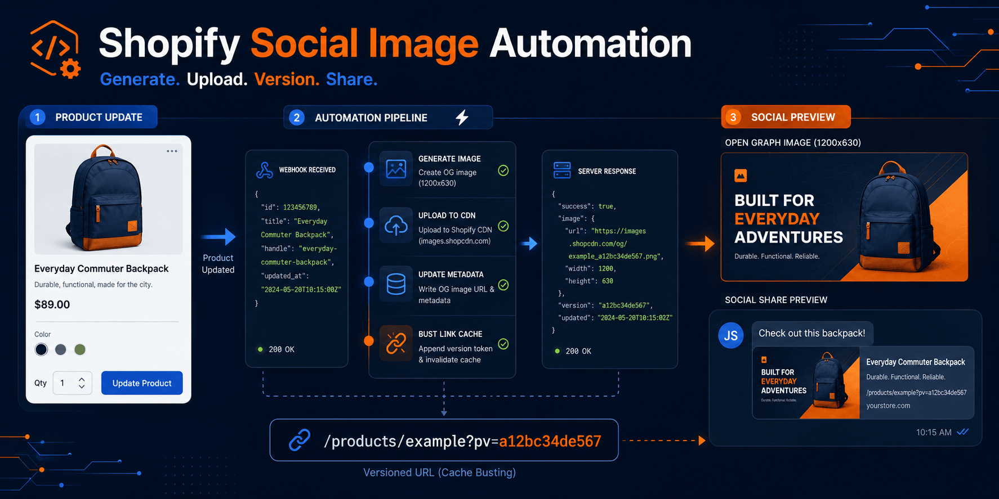

# Shopify Social Image Automation: Auto-Generate Open Graph Images for Products

A multi-store **Shopify app** that automatically generates branded **1200 × 628 Open Graph (OG) images** whenever a product is created or updated. Images are built with **Sharp**, uploaded to each merchant's own **Shopify Files** and written back to product metafields, so every shared product link shows a clean promotional preview on WhatsApp, Facebook and other social apps.

**App:** [shopify-image-app-seven.vercel.app](https://shopify-image-app-seven.vercel.app)

## ✨ Features

- **Automatic OG images** for single products, plus four-card **roundup images** for deal pages.
- **Webhook-driven.** Signed `products/create` and `products/update` webhooks trigger generation; unchanged input is skipped.
- **Merchant-owned storage.** Images go to the merchant's own Shopify Files (Shopify CDN), not a third-party bucket.
- **Promo overrides per product** through metafields: badge text, sale price, regular price and headline.
- **Cache busting without scraper APIs.** A stable `pv` sharing version in the storefront URL makes social apps fetch the new preview.
- **Secure multi-store install.** App Bridge ID-token auth, encrypted offline tokens per shop, HMAC-verified webhooks and the mandatory privacy webhooks.
- **Theme app embed** that adds the social preview metadata without editing theme code.

## 🛠 Tech Stack

`Node.js` `Express` `Shopify GraphQL Admin API` `Shopify App Bridge` `Theme App Extensions` `Sharp` `PostgreSQL` `Vercel`

## 🛍 Merchant experience

After the app is distributed, a merchant only needs to:

1. Install the app and approve its Shopify scopes.
2. Upload their logo and confirm their public storefront domain.
3. Open the provided theme-editor link, enable the Social preview metadata app embed, and save the theme.
4. Save a product. Promo images are on by default; set Enable promo image to false to skip one.

The app handles Shopify-managed installation, embedded ID-token authentication, encrypted offline-token storage, product webhooks, metafield definitions, image upload, and version metadata. Merchants don't create webhooks or metafield definitions manually.

## ⚙️ Processing flow

```text
Shopify app installation
        |
        +-- App Bridge supplies a signed Shopify ID token
        +-- The backend validates it and exchanges it for an offline token
        +-- Access and refresh tokens are encrypted and stored per shop
        +-- Product metafield definitions are created
        +-- Merchant uploads a logo to their own Shopify Files

Signed products/create or products/update webhook
        |
        +-- Resolve the sending shop and its token
        +-- Read deal overrides and stored versions
        +-- Resolve selected products when custom.roundup_deals is populated
        +-- Skip unchanged input
        +-- Generate a single-product or four-card roundup image
        +-- Upload a versioned file to Shopify Files
        +-- Write OG image and sharing versions in one mutation
```

Facebook's scraper API is not called. Cache invalidation uses the stable `pv` sharing version in the storefront URL.

<details>
<summary><b>Shopify configuration and metafields</b></summary>

The checked-in [shopify.app.toml](shopify.app.toml) declares:

- `read_products`
- `write_products`
- `read_files`
- `write_files`
- `products/create` and `products/update` webhooks
- `app/uninstalled` cleanup
- mandatory customer/shop privacy webhooks
- the theme app extension under `extensions/social-preview`

Shopify manages installation and scope grants. The embedded app authenticates backend requests with App Bridge ID tokens, while Shopify's CLI applies app-specific webhook subscriptions consistently to installed shops when a version is deployed.

The app creates these merchant-owned product metafield definitions during installation:

| Metafield | Type | Purpose |
| --- | --- | --- |
| `custom.deal_enabled` | Boolean | Defaults to enabled when unset. Set False to disable generation for the product. |
| `custom.deal_badge_text` | Single line text | Badge override; `hide` removes it. |
| `custom.deal_sale_price` | Single line text | Sale-price override; `hide` removes prices. |
| `custom.deal_reg_price` | Single line text | Regular-price override. |
| `custom.deal_title` | Single line text | Promotional headline. |
| `custom.og_image` | Single line text | Generated Shopify CDN URL. |
| `custom.og_version` | Single line text | Generated-image hash. |
| `custom.share_version` | Single line text | Customer-visible sharing-state hash. |
| `custom.og_image_input_hash` | Single line text | Image-input idempotency hash. |

Roundup products can additionally use `custom.roundup_page_title` and the `custom.roundup_deals` list of product references. When selected deals are present, the webhook generates a 1200 x 628 roundup preview automatically; the normal product-image path remains unchanged for every other product.

The `custom` namespace is retained for compatibility with stores already using the prototype.

</details>

<details>
<summary><b>Environment variables</b></summary>

Copy `.env.example` to `.env` for local development.

Required for installable mode:

| Variable | Purpose |
| --- | --- |
| `APP_URL` | Public HTTPS base URL of the app. Use the current tunnel URL during local Shopify testing. |
| `SHOPIFY_API_KEY` | Shopify app client ID. |
| `SHOPIFY_API_SECRET` | Shopify app client secret and webhook HMAC secret. |
| `SHOPIFY_TOKEN_ENCRYPTION_KEY` | Separate random secret used to encrypt offline tokens at rest. |
| `DATABASE_URL` | PostgreSQL connection string. Required on Vercel; local development can omit it. |
| `SHOPIFY_API_VERSION` | Defaults to `2026-07`. |
| `SHOPIFY_SCOPES` | Defaults to the four scopes declared above. |

Generate the encryption secret locally with Node:

```powershell
node -e "console.log(require('crypto').randomBytes(32).toString('hex'))"
```

Local development without `DATABASE_URL` stores encrypted installation records in `.data/shop-installations.json`. That folder is ignored by Git. Vercel refuses installable mode without PostgreSQL because its filesystem is ephemeral.

The previous `SHOPIFY_SHOP_DOMAIN`, `SHOPIFY_CLIENT_ID`, `SHOPIFY_CLIENT_SECRET`, and `SHOPIFY_WEBHOOK_SECRET` variables remain as a temporary single-store compatibility path. New installations do not use them.

`FB_APP_SECRET` remains in use by the separate WhatsApp webhook signature check. It is no longer used for Shopify/OG cache scraping.

</details>

## 🚀 Run locally

```powershell
npm install
npm test                 # full test suite
npm run test:generate    # generate local image fixtures
npx --yes @shopify/cli@latest app build   # validate app config and theme extension
npm start
```

Then check `http://localhost:3000/health` and the onboarding screen at `http://localhost:3000/`.

<details>
<summary><b>Pre-live test sequence</b></summary>

Keep this work on a feature branch until all checks pass:

1. Run `npm test` and the Shopify CLI build.
2. Create a preview deployment with a preview PostgreSQL database.
3. Link a Shopify development app configuration to the preview URL.
4. Install it on a development store.
5. Upload a test logo from the app dashboard.
6. Activate the theme app embed and save the theme.
7. Enable a product, save it, and confirm the generated Shopify File and four output metafields.
8. Inspect the product page source for the generated `og:image` and versioned `og:url`.
9. Test the exact `?pv=` URL with an external crawler. A password-protected development storefront cannot complete this final crawler check.

Do not deploy the Shopify app version or merge the feature branch until this sequence is approved.

</details>

<details>
<summary><b>Production notes</b></summary>

- Arbitrary unrelated merchants require public distribution and Shopify App Review. Custom distribution is limited to one store or stores in the same eligible organization.
- Theme app embeds are disabled by default after installation; the merchant must confirm activation and save once.
- Some themes already render their own OG tags. Duplicate-tag behavior must be tested on target themes before release.
- `X-Shopify-Webhook-Id` persistence is still recommended for strict duplicate-delivery tracking. The current content hashes make repeated product deliveries idempotent, but a dedicated webhook-delivery table is the stronger production design.
- Never commit `.env`, `.env.bridge`, PostgreSQL credentials, access tokens, or Shopify secrets.
- This repository also contains a WhatsApp-to-Codex bridge. That bridge is independent from merchant Shopify installations.

</details>

## 📁 Project structure

```text
api/                         Vercel function entry point
assets/                      Legacy default logo and test assets
extensions/social-preview/   Theme app embed and pv URL script
scripts/                     Bridge, Shopify, and image test utilities
src/image/                   Sharp image generator
src/pages/                   Legal and merchant onboarding pages
src/shopify/                 OAuth, encrypted installations, API clients, files, metafields
src/webhooks/                Shopify product and WhatsApp webhook handlers
tests/                       Regression and installable-app security checks
```

## 👋 Built by

**Muhammad Mustafa**, Senior Full-Stack SaaS & AI Developer with 10+ years of experience and Co-Founder of StartStorez (2,000+ Shopify stores delivered). I build Shopify apps, SaaS products and AI features with Node.js, React and Next.js.

**Need a custom Shopify app or automation?** [aisaaswithmustafa.com](https://aisaaswithmustafa.com/) · [LinkedIn](https://www.linkedin.com/in/muhammad-mustafa-16477a99/) · [Email](mailto:mustufa50@gmail.com)

## License

No open-source license is included. All rights reserved.
